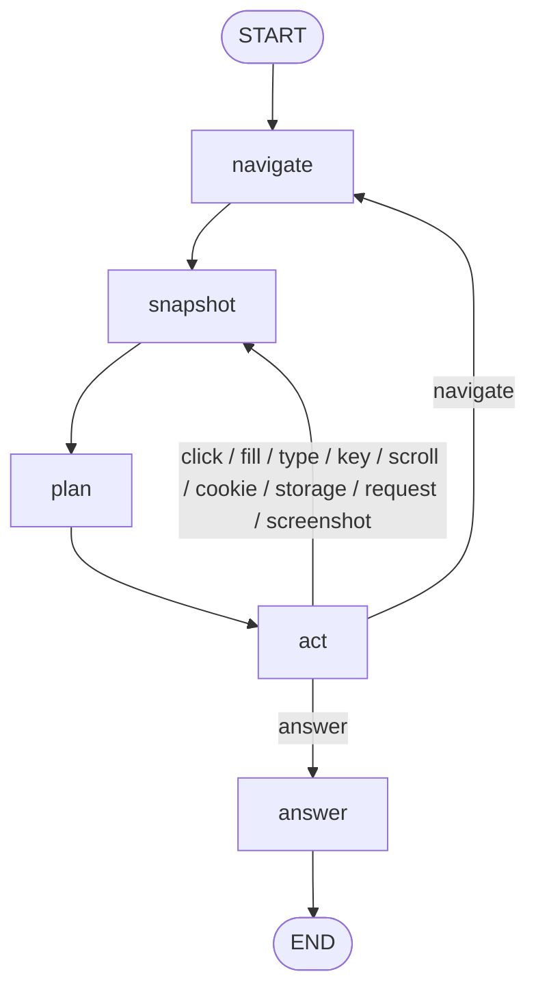

# FastBrowse

An LLM-driven web-browsing agent built on [LangGraph](https://langchain-ai.github.io/langgraph/)
and [Playwright](https://playwright.dev/python/).

FastBrowse drives a real browser toward a natural-language goal. Planning and form
text generation use an OpenAI chat model, while routing and element selection use
[`langchain-typesafe`](https://pypi.org/project/langchain-typesafe/) categorical
decisions. The agent loops — snapshot the page, plan, route, pick an element, act —
until it decides the goal is complete.

## How it works



The planning node asks the chat model for a structured `PlanUpdate` (an ordered
plan plus the single goal to pursue next). The `act` node sends a **single**
TypeSafe request per cycle carrying the operation (`click` / `fill` / `scroll` /
`navigate` / `cookie` / `storage` / `request` / `screenshot` / `answer`) plus
speculative heads for the offered operations (`click_target`, `fill_target`,
`cookie_action`, `storage_action`, `request_method`); only the head matching the
chosen operation is executed. When the task is complete, `act` routes to the
`answer` node, which asks the chat model for the final answer.

### Nodes

| Node | Purpose |
| --- | --- |
| `navigate` | Choose a URL (via the decision model when several are queued) and navigate the page, recording the navigation (or the decision to stay) as an observation. |
| `snapshot` | Capture an aria snapshot and the interactive elements across every frame into state; record an observation when the page URL or element set changed. |
| `plan` | Ask the chat model for an updated plan and current goal, forcing a rewrite when the page has stalled. |
| `act` | One decision request: pick an operation and its target, run it, then loop or route to `navigate`/`answer`. Operations include clicking, filling, typing text (`type`) or pressing a single key such as Enter (`key`), scrolling, cookies, localStorage/sessionStorage, HTTP requests, and screenshots. Bounded by the step/stall/failure guards. |
| `answer` | Ask the chat model for the final answer from the goal, page text, and observations, then end. |

## Requirements

- Python >= 3.12
- [`uv`](https://docs.astral.sh/uv/)
- Playwright's Chromium browser

## Install

```bash
uv sync
uv run playwright install chromium
```

## Configuration

Copy the example environment file and fill in your credentials:

```bash
cp .env.example .env
```

| Variable | Purpose |
| --- | --- |
| `OPENAI_API_KEY` | API key for the chat model. |
| `OPENAI_BASE_URL` | Optional base URL for the chat model endpoint. |
| `OPENAI_MODEL` | Model used for planning and generating form text. |
| `TYPESAFE_API_KEY` | API key for the decision model. |
| `TYPESAFE_BASE_URL` | Base URL for the decision model endpoint. |
| `TYPESAFE_MODEL` | Model used for routing and element selection. |

Settings are loaded with `pydantic-settings` from the environment and `.env`.

## Usage

### Command line

```bash
uv run fastbrowse \
  --prompt "Find the price of the Pro plan" \
  --url "https://example.com"
```

Show the browser window instead of running headless:

```bash
uv run fastbrowse --prompt "..." --url "https://example.com" --headed
```

When the run finishes it prints the current goal, the plan, and the accumulated
observations.

| Flag | Required | Description |
| --- | --- | --- |
| `--prompt` | yes | Task/goal for the agent. |
| `--url` | yes | Starting URL. |
| `--headed` | no | Show the browser window (default is headless). |

### MCP server

Running `fastbrowse` with no arguments starts the [FastMCP](https://gofastmcp.com/)
server over stdio and exposes a single `browse` tool:

| Argument | Required | Description |
| --- | --- | --- |
| `prompt` | yes | Task/goal for the agent. |
| `url` | yes | Starting URL. |
| `headed` | no | Show the browser window (default is headless). |

The tool returns the final `answer`, the current `goal`, the `plan`, and the
accumulated `observations`.

Register it with an MCP client, for example in `.mcp.json`:

```json
{
  "mcpServers": {
    "fastbrowse": {
      "command": "uv",
      "args": ["run", "--directory", "/path/to/fastbrowse", "fastbrowse"]
    }
  }
}
```

The server can also be launched directly through the FastMCP CLI:

```bash
uv run fastmcp run src/fastbrowse/mcp/server.py:mcp
```

## Architecture

```
src/fastbrowse/
├── cli.py              # argparse entry point (the `fastbrowse` script)
├── config.py           # pydantic-settings, reads .env
├── logging.py          # logger setup + decision logging
├── adapter/
│   ├── llm.py          # ChatOpenAI factory
│   └── decision.py     # TypeSafeClassifier factory
├── mcp/
│   └── server.py       # FastMCP server exposing the `browse` tool
└── agent/
    ├── agent.py        # graph nodes, graph assembly, run()
    ├── helpers.py      # non-node helpers (planning, selection, actions, guards)
    ├── state.py        # State TypedDict
    ├── context.py      # Playwright browser/page runtime context
    ├── snapshot.py     # Element model + page snapshot capture
    ├── tools.py        # browser actions (page-based helpers)
    ├── prompt.py       # prompt text
    └── utils.py        # shared helpers (decision classify, etc.)
```

### State

The graph state (`agent/state.py`) is a `TypedDict`:

| Field | Description |
| --- | --- |
| `prompt` | The user's task. |
| `urls` | Candidate URLs to navigate to. |
| `current_url` | URL at the last navigation/snapshot, used to detect page changes. |
| `steps` | Number of `act` cycles run so far (loop guard). |
| `stall` | Consecutive snapshots with no page change (loop guard). |
| `failures` | Consecutive actions that failed; failures are recorded as observations, rewrite the plan at 2, and stop the run at 4. |
| `snapshot` | Latest aria snapshot text. |
| `elements` | Interactive `Element`s captured from the page. |
| `plan` | Current ordered plan. |
| `current_goal` | The single goal being pursued. |
| `observations` | Accumulated action results, including navigations and snapshot changes. |
| `messages` | LangChain messages (reducer-accumulated). |
| `answer` | Final answer produced by the `answer` node. |

## Development

Type checking uses `basedpyright` (configured under `[tool.basedpyright]` in
`pyproject.toml`):

```bash
uv run basedpyright
```

There is no test suite yet.

## Notes

- Both the OpenAI and TypeSafe endpoints require valid credentials.
- The checkpointer is in-memory, so runs are not persisted between processes.
- The agent operates on a single page but snapshots and acts across all frames on
  that page (including iframes).
- Cookie, storage, and HTTP-request operations reuse the page's session. Their
  free-form arguments (cookie name/value, storage key/value, request URL/body) are
  generated by the chat model, one value per call.
- The loop is bounded: after `MAX_STEPS` act cycles, or `MAX_STALL` consecutive
  snapshots with no page change, `act` routes straight to `answer` with what it has.
  Once the page stops changing (`STALL_LIMIT`), `scroll` is withdrawn from the
  offered operations and the plan is rewritten, so the agent cannot spin on scroll.
  A matching `recursion_limit` is passed to the graph as a backstop.
